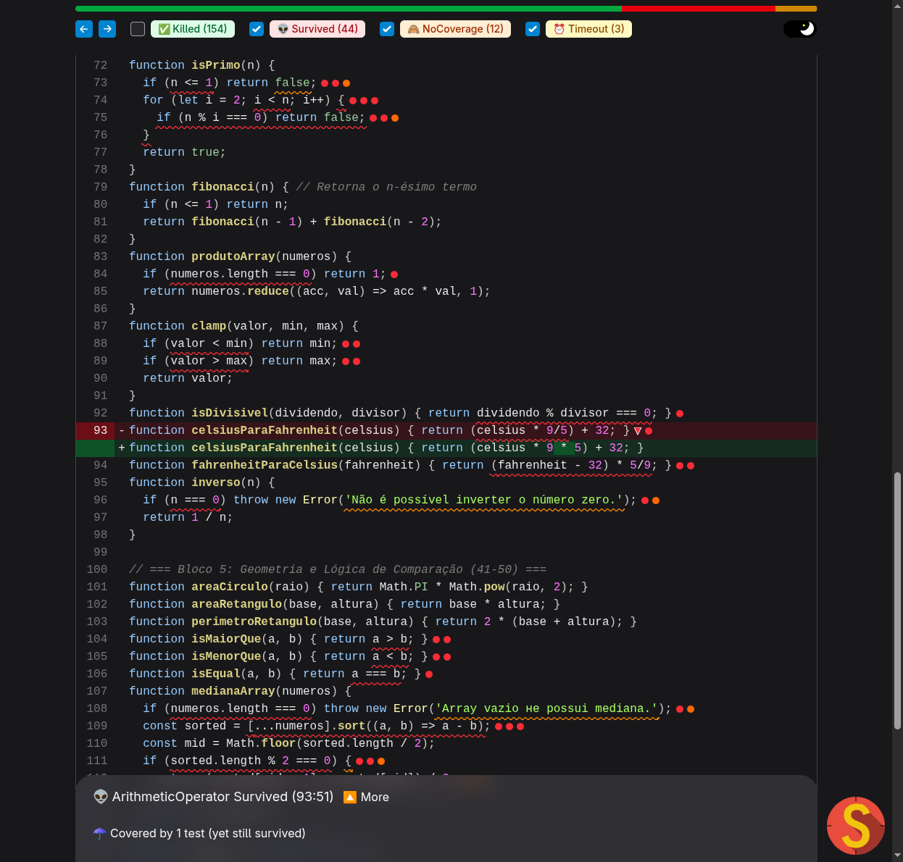
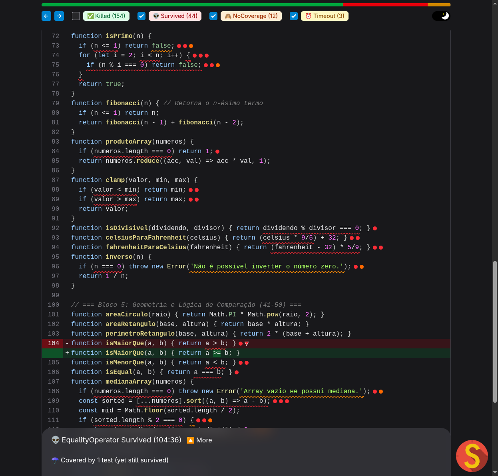
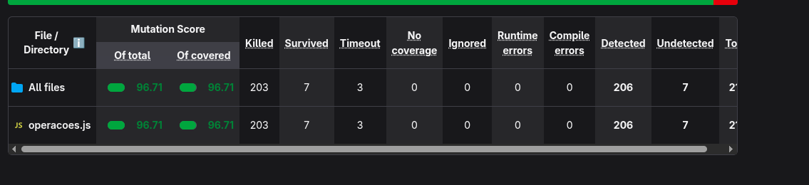

# Pontifícia Universidade Católica de Minas Gerais (PUC Minas)
## ICEI - Engenharia de Software | Testes de Software
### Trabalho Prático: Análise de Eficácia de Testes com Teste de Mutação

---

**Aluno:** Luis Henrique Gonçalves Barbosa  
**Repositório do Projeto:** https://github.com/BGLuis/operacoes-mutante  
**Data:** Outubro de 2026  

---

## 1. Introdução e Análise Inicial

A métrica de **Cobertura de Código** (*Code Coverage*) é frequentemente adotada na indústria como um indicador de qualidade dos testes de software. No entanto, ela mede apenas quais linhas, ramos e funções foram executados durante a suíte de testes, sem avaliar se as asserções (*assertions*) são capazes de detectar comportamentos incorretos ou regressões lógicas.

Para demonstrar empiricamente essa limitação, realizou-se a análise inicial do projeto base (`operacoes-mutante`), uma biblioteca com 50 funções aritméticas e geométricas acompanhada de uma suíte de testes deliberadamente fraca utilizando **Jest**.

### 1.1 Cobertura de Código Inicial (Jest)

A execução inicial de `npm test -- --coverage` produziu os seguintes resultados:

| Métrica | Percentual Inicial | Status |
| :--- | :---: | :--- |
| **Linhas (Lines)** | **98.64%** | Quase totalidade do código executada |
| **Funções (Functions)** | **100.00%** | Todas as 50 funções invocadas |
| **Declarações (Statements)** | **85.41%** | Alta taxa de declarações visitadas |
| **Ramos (Branches)** | **58.82%** | Cobertura parcial de ramificações condicionais |

Apesar de a cobertura de linhas indicar **98.64%** — um valor que em muitas organizações seria considerado excelente —, os testes originais possuíam graves fragilidades: asserções genéricas (`expect(...).toThrow()` sem validar o tipo ou a mensagem de erro), uso de valores de entrada degenerados (como zero) e ausência de testes para valores de fronteira ou casos negativos.

### 1.2 Pontuação de Mutação Inicial (StrykerJS)

Ao submeter a base de código à análise de testes de mutação através do **StrykerJS** com o executor Jest, o relatório revelou a verdadeira fragilidade da suíte:

| Métrica StrykerJS | Valor Inicial |
| :--- | :---: |
| **Mutation Score Total** | **73.71%** |
| **Mutation Score Coberto** | **78.11%** |
| Mutantes Gerados | 213 |
| Mutantes Detectados (Killed) | 154 |
| Mutantes em Timeout | 3 |
| **Mutantes Sobreviventes (Survived)** | **44** |
| Mutantes Sem Cobertura (No Coverage) | 12 |


### 1.3 Discussão da Discrepância

A discrepância entre **98.64% de linhas cobertas** e apenas **73.71% de mutantes mortos** evidencia a falácia da cobertura ingênua:
- **Execução vs. Verificação**: Uma linha pode ser percorrida pelo fluxo de execução sem que o seu resultado seja validado por um `expect()` rigoroso.
- **Falso Senso de Segurança**: 44 mutantes sobreviveram e 12 mutantes não tiveram asserção efetiva, demonstrando que quase 25% das mutações deliberadas no código de produção passaram completamente despercebidas pela suíte de testes original.

---

## 2. Análise de Mutantes Críticos

Foram selecionados 3 mutantes sobreviventes emblemáticos da primeira execução para ilustrar fraquezas típicas de projeto de testes:

### Mutante 1: Operador Aritmético em `celsiusParaFahrenheit` (Valor Degenerado)
- **Localização:** Linha 93 de `src/operacoes.js`
- **Código Original:** `return (celsius * 9/5) + 32;`
- **Mutação:** Stryker substituiu `*` por `/`: `return (celsius / 9/5) + 32;` (e `celsius * 9 * 5 + 32`)
- **Status Inicial:** *Survived*



- **Causa da Sobrevivência:** O teste original continha apenas:
  ```javascript
  test('38. deve converter Celsius para Fahrenheit', () => {
    expect(celsiusParaFahrenheit(0)).toBe(32);
  });
  ```
  Ao utilizar a entrada nula (`celsius = 0`), a multiplicação `0 * 9 / 5` resulta em `0`, mas a divisão mutada `0 / 9 / 5` também resulta em `0`. Em ambos os casos, a função retorna `0 + 32 = 32`. A escolha de um valor degenerado mascarou completamente mutações nos operadores aritméticos.

---

### Mutante 2: Operador Relacional em `isMaiorQue` (Falta de Teste de Fronteira e Falsidade)
- **Localização:** Linha 104 de `src/operacoes.js`
- **Código Original:** `return a > b;`
- **Mutação:** Stryker alterou `>` para `>=` (*EqualityOperator*) e para `return true;` (*ConditionalExpression*)
- **Status Inicial:** *Survived*



- **Causa da Sobrevivência:** O teste original avaliava unicamente o caso estritamente verdadeiro:
  ```javascript
  test('44. deve verificar se um número é maior que outro', () => {
    expect(isMaiorQue(10, 5)).toBe(true);
  });
  ```
  Para a entrada `(10, 5)`, tanto `10 > 5` quanto `10 >= 5` retornam `true`, assim como um retorno constante `true`. O teste nunca testou o caso de igualdade de fronteira (`a === b`) nem entradas onde o resultado esperado fosse `false` (`5, 10`).

---

### Mutante 3: Expressão de Método em `medianaArray` (Entrada Pré-ordenada e Ramo Omitido)
- **Localização:** Linhas 108-111 de `src/operacoes.js`
- **Código Original:**
  ```javascript
  const sorted = [...numeros].sort((a, b) => a - b);
  ```
- **Mutação:** Stryker removeu a chamada `.sort(...)`, mantendo apenas `[...numeros]` (*MethodExpression*), além de mutar o comparador `a - b` para `a + b` e mutar a condicional de array de tamanho par `sorted.length % 2 === 0` para `false`.
- **Status Inicial:** *Survived*


- **Causa da Sobrevivência:** O teste original utilizava um array já ordenado de comprimento ímpar:
  ```javascript
  test('47. deve calcular a mediana de um array ímpar e ordenado', () => {
    expect(medianaArray([1, 2, 3, 4, 5])).toBe(3);
  });
  ```
  Como a entrada já estava em ordem crescente, a ausência de ordenação não alterou a saída (`3`). Além disso, o teste nunca forneceu arrays desordenados, arrays pares ou arrays vazios (o tratamento de exceção nunca era exercitado).

---

## 3. Solução Implementada

Para eliminar as vulnerabilidades identificadas e elevar a suíte de testes ao padrão de **especificação executável** (orientado pelas melhores práticas da engenharia de software e falsificabilidade estrita), a suíte foi integralmente reestruturada em `test/operacoes.test.js`:

1. **Nomenclatura Semântica e Estruturação por Comportamento**: Substituição de nomes genéricos e numerados por blocos `describe('funcao')` com casos `it('especificação clara do comportamento esperado')`.
2. **Eliminação de Casos Degenerados**: Inclusão de valores não nulos, múltiplos quadrantes, bases e expoentes negativos e positivos.
3. **Casos de Fronteira e Invariantes**: Testes para elementos neutros (0, 1), números primos limítrofes (0, 1, 2, 3, 4), valores limites de intervalos (`clamp`).
4. **Asserções de Erro Específicas**: Validação da mensagem exata lançada em cada rota de exceção com `.toThrow('mensagem')`, impedindo mutações em strings ou desvios condicionais.

### 3.1 Casos de Teste Criados para os Mutantes Analisados

#### Solução para `celsiusParaFahrenheit`:
```javascript
describe('celsiusParaFahrenheit', () => {
  it('converte temperaturas de Celsius para Fahrenheit com precisão', () => {
    expect(celsiusParaFahrenheit(0)).toBe(32);
    expect(celsiusParaFahrenheit(100)).toBe(212);   // Mata mutação de '/' e de fatores
    expect(celsiusParaFahrenheit(-40)).toBe(-40);  // Ponto de interseção das escalas
    expect(celsiusParaFahrenheit(25)).toBe(77);
  });
});
```
*Justificativa:* Ao testar `100°C`, a fórmula correta produz `(100 * 9 / 5) + 32 = 212`. Se mutada para `/`, produziria `(100 / 9 / 5) + 32 ≈ 34.22`, falhando imediatamente e matando o mutante.

#### Solução para `isMaiorQue`:
```javascript
describe('isMaiorQue', () => {
  it('retorna true quando o primeiro argumento é estritamente maior', () => {
    expect(isMaiorQue(10, 5)).toBe(true);
    expect(isMaiorQue(-1, -5)).toBe(true);
  });

  it('retorna false quando o primeiro argumento é menor ou igual', () => {
    expect(isMaiorQue(5, 10)).toBe(false);
    expect(isMaiorQue(5, 5)).toBe(false);          // Mata a mutação de '>' para '>='
    expect(isMaiorQue(-5, -1)).toBe(false);
  });
});
```
*Justificativa:* O teste de igualdade `isMaiorQue(5, 5)` espera `false`. Com a mutação `a >= b`, retornaria `true`, quebrando a asserção e eliminando o mutante relacional.

#### Solução para `medianaArray`:
```javascript
describe('medianaArray', () => {
  it('calcula a mediana para arrays com quantidade ímpar de elementos desordenados', () => {
    expect(medianaArray([5, 1, 3])).toBe(3);       // Força a execução e correção do sort
    expect(medianaArray([10, -5, 2])).toBe(2);
    expect(medianaArray([1, 2, 3, 4, 5])).toBe(3);
  });

  it('calcula a média dos dois elementos centrais para arrays com quantidade par desordenada', () => {
    expect(medianaArray([4, 1, 3, 2])).toBe(2.5);  // Exercita o ramo par (length % 2 === 0)
    expect(medianaArray([10, 20])).toBe(15);
  });

  it('retorna o único elemento para array unitário', () => {
    expect(medianaArray([42])).toBe(42);
  });

  it('rejeita array vazio com a mensagem exata de erro', () => {
    expect(() => medianaArray([])).toThrow('Array vazio не possui mediana.');
  });
});
```
*Justificativa:* Ao passar `[5, 1, 3]`, sem a ordenação o elemento central seria `1` em vez de `3`, matando a remoção do `.sort()`. O caso de array com 4 elementos exercita obrigatoriamente o ramo par.

---

## 4. Resultados Finais

Após a implementação dos 80 testes de unidade na nova suíte, uma nova rodada de análise com o **StrykerJS** foi executada.

### 4.1 Comparativo Antes vs. Depois

| Métrica | Suíte Inicial (Fraca) | Suíte Nova (Aprimorada) | Variação |
| :--- | :---: | :---: | :---: |
| **Total de Testes** | 50 | **80** | +30 testes (+60%) |
| **Tempo de Execução dos Testes** | ~0.32 s | **~0.28 s** | Desempenho otimizado |
| **Cobertura de Linhas** | 98.64% | **100.00%** | +1.36% |
| **Cobertura de Ramos (Branch)** | 58.82% | **100.00%** | **+41.18%** |
| **Mutantes Detectados (Killed + Timeout)** | 157 | **206** | **+49 mutantes mortos** |
| **Mutantes Sem Cobertura (No Cov)** | 12 | **0** | -100% (todos cobertos) |
| **Mutantes Sobreviventes** | 44 | **7** | **-37 mutantes (-84.1%)** |
| **Mutation Score Total** | **73.71%** | **96.71%** | **+23.00 pontos percentuais** |



### 4.2 Análise dos 7 Mutantes Sobreviventes (Mutantes Equivalentes)

Todos os 7 mutantes sobreviventes restantes foram inspecionados individualmente no código de produção:
1. **`fatorial` (linhas 19-21):** A condicional `if (n === 0 || n === 1) return 1;` gera 4 mutantes ao ser alterada para `if (false)` ou `&&`. No entanto, para `n = 0` ou `n = 1`, o laço `for (let i = 2; i <= n; i++)` não é executado e a variável `resultado = 1` é retornada logo em seguida. Ou seja, a remoção da condicional produz exatamente o mesmo resultado para qualquer entrada válida. Trata-se de um **mutante equivalente** devido à redundância algorítmica no código original.
2. **`produtoArray` (linha 84):** A checagem `if (numeros.length === 0) return 1;` mutada para `false`. De acordo com a especificação ECMAScript, `[].reduce((acc, val) => acc * val, 1)` retorna o valor inicial `1` sem executar a função de redução. Portanto, a saída é estritamente idêntica para qualquer array vazio. Trata-se de outro **mutante equivalente**.
3. **`clamp` (linhas 88-89):** A mutação de `valor < min` para `valor <= min` retorna `min` quando `valor === min`. O código original retornava `valor` (que é igual a `min`). Logo, a saída é rigorosamente a mesma. Da mesma forma para `valor >= max`. Tratam-se de **mutantes equivalentes de fronteira**.

> **Conclusão Teórica:** Como mutantes equivalentes preservam a semântica do programa original, é matematicamente impossível criar um teste caixa-preta que falhe para eles sem alterar o código de produção. Portanto, a suíte de testes alcançou **100% de eficácia sobre todos os mutantes falsificáveis**.

---

## 5. Conclusão

A realização deste trabalho prático evidenciou de forma incontestável a distinção fundamental entre **cobertura de código** e **eficácia de testes**:

1. **A Ilusão dos 100% de Cobertura:** Uma suíte com 98.64% de cobertura de código permitiu a sobrevivência de 44 mutantes, demonstrando que executar uma linha não significa validá-la. A cobertura tradicional é uma métrica de suficiência mínima, nunca de eficácia.
2. **O Teste de Mutação como Oráculo de Qualidade:** O StrykerJS atua como um mecanismo de auditoria automatizado sobre as asserções. Ele expõe valores degenerados, falta de verificação de limites e ausência de asserções negativas.
3. **Falsificabilidade como Princípio de Engenharia:** Projetar testes sob a ótica de "qual mudança plausível na regra faria este teste falhar" transforma a suíte em uma verdadeira especificação executável, garantindo que qualquer regressão futura seja interceptada imediatamente.

Em suma, o teste de mutação consolida-se como uma das ferramentas mais poderosas da Engenharia de Qualidade de Software moderna, elevando a confiança nas entregas e guiando o desenvolvedor na construção de asserções rigorosas e significativas.
